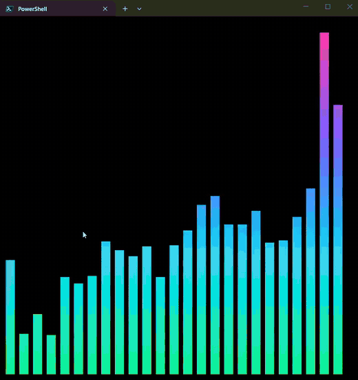
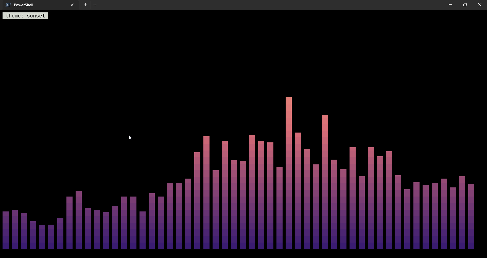
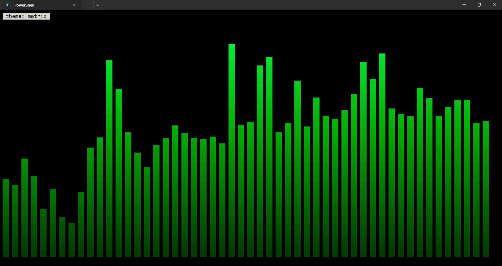
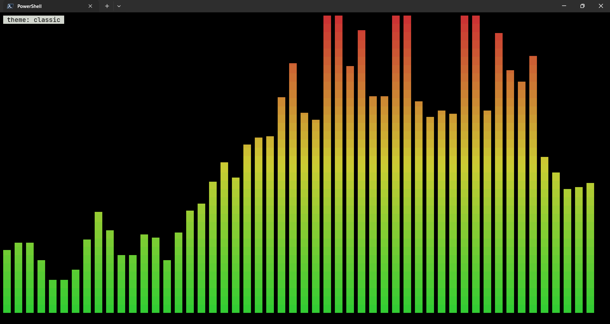
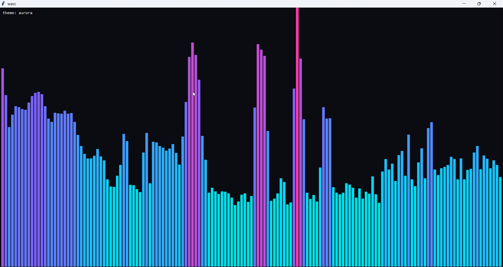
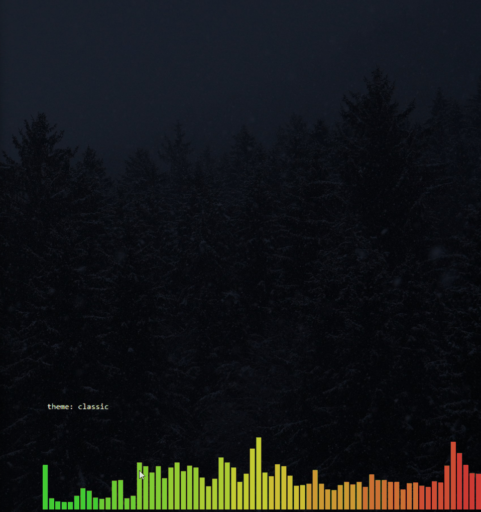
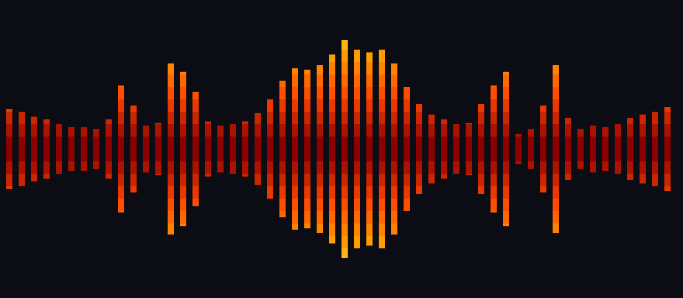

# wavc-viz — Windows Audio Visualiser Console

> The command is **`wavc`** (alias `wavc-viz`); the project and PyPI package are called **wavc-viz**.

**A [CAVA](https://github.com/karlstav/cava)-inspired audio spectrum visualiser for Windows.**
It captures whatever your PC is playing (WASAPI loopback), runs it through an FFT, and draws
smooth, gravity-damped bars — in your terminal or in a native window.

> *wavc-viz is an independent project, not affiliated with CAVA.*

[](https://github.com/Annaelle0/wavc-viz/actions/workflows/ci.yml)


<p align="center">
  
</p>
<p align="center">
  <sub>Real capture, no audio: terminal themes switching live with <code>c</code>, then the native window (<code>--gui</code>).
  <a href="docs/demo.mp4">Higher-quality video</a></sub>
</p>

## Features

- **Captures what you hear** — WASAPI loopback of the default output device, no "Stereo Mix" or
  virtual cable needed. Also supports microphones / line-in.
- **CAVA-style motion** — logarithmic frequency bands, multi-resolution FFT (long window for
  bass, short for treble), autosens, gravity + integral smoothing, optional *monstercat* spreading.
- **Sharp terminal rendering** — 1/8-cell vertical precision using block glyphs, truecolor
  gradients, `bottom` / `top` / `mirror` orientations, mono or stereo (bass in the middle).
- **Native window mode** — tkinter window with a borderless, always-on-top, **transparent
  desktop-widget** option. Drag to move, right-click to close.
- **10 built-in themes** + custom gradients, per-bar horizontal or per-height vertical coloring.
- **Live controls** — change sensitivity, theme, layout and smoothing with single keystrokes.
- **Robust** — copes with silence (loopback sends no packets while nothing plays), device
  switches (plugging in headphones), and terminal resizes.
- **Single `.exe`** available from Releases; or `pip install`.

## Gallery

Real captures of wavc-viz playing music on Windows: terminal themes, the native window, and the
transparent desktop widget.

<p align="center">
  
  
  
</p>
<p align="center">
  
  
</p>

**More layouts** (rendered from the built-in demo signal with `scripts/make_screenshots.py`):
mirrored stereo (`-o mirror --stereo`) and a horizontal gradient with monstercat smoothing.

<p align="center">
  
  
</p>

## Install

### Option A — standalone exe
Download `wavc.exe` from the [Releases](https://github.com/Annaelle0/wavc-viz/releases)
page and run it from [Windows Terminal](https://aka.ms/terminal).

### Option B — pip / pipx (Python 3.9 or newer)

> **Requires Python 3.9 or newer** (check with `python --version`). The test suite passes on
> Python 3.9 through 3.14, and the audio library
> [PyAudioWPatch](https://github.com/s0d3s/PyAudioWPatch) publishes Windows wheels for all of them.
> If `pip install` can't find it, run `python -m pip install --upgrade pip` and try again.
> `wavc --demo` needs no audio library at all.

```powershell
pipx install wavc-viz            # once published on PyPI
# or straight from GitHub:
pipx install git+https://github.com/Annaelle0/wavc-viz
# or with pip:
pip install git+https://github.com/Annaelle0/wavc-viz
```

### Option C — from source

```powershell
git clone https://github.com/Annaelle0/wavc-viz
cd wavc-viz
pip install -e .
```

## Quick start

```powershell
wavc                  # visualize your system audio (play some music first!)
wavc --demo           # built-in synthetic music, no audio needed
wavc --gui            # native window instead of the terminal
wavc -t fire -o mirror --stereo
wavc --list-devices   # see loopback and input devices
wavc --init-config    # write a commented config to %APPDATA%\wavc\config.ini
```

> **Use Windows Terminal** (default on Windows 11) for the best result: it handles truecolor and
> 60 fps updates smoothly. The legacy `conhost` window works but is slower; use `--fps 30` there.

## Keys (terminal and GUI)

| Key | Action |
|-----|--------|
| `q` / `Esc` | quit |
| `↑` / `↓` | sensitivity ±10 % (turns autosens off) · mouse wheel in GUI |
| `a` | toggle autosens |
| `←` / `→` | bar width |
| `c` | next color theme |
| `g` | gradient direction (vertical / horizontal) |
| `o` | orientation: bottom → top → mirror |
| `s` | mono / stereo |
| `r` | reverse frequency order |
| `m` | monstercat smoothing on/off |
| `n` / `N` | more / less smoothing |
| `Space` | pause |
| `f` | fps counter |
| `h` | help overlay |

GUI extras: drag with the left mouse button, double-click toggles the window border, right-click quits.

## Command line

| Option | Description |
|--------|-------------|
| `-c, --config FILE` | config file (default `%APPDATA%\wavc\config.ini`) |
| `-s, --source {loopback,input,demo}` / `--demo` | audio source |
| `-d, --device NAME\|INDEX` | pick a specific device (see `--list-devices`) |
| `-b, --bars N` | bar count, `0` = fit to width |
| `-t, --theme NAME` / `--gradient C1,C2,…` | colors |
| `-o, --orientation {bottom,top,mirror}` | bar direction |
| `--stereo` | left/right channels, bass in the centre |
| `--gui` | native window |
| `--fps N`, `--bar-width N`, `--bar-spacing N` | layout / speed |
| `--no-autosens`, `--sensitivity PCT` | manual gain |
| `--noise-reduction 0-100`, `--monstercat` | smoothing |
| `--ascii` | ASCII glyphs instead of block characters |
| `--list-devices`, `--list-themes`, `--init-config [PATH] [--force]` | helpers |

CLI options override the config file, which overrides the defaults.

## Configuration

`wavc --init-config` writes a fully commented file. Full-line comments start with `#` or
`;`; **inline comments must use `;`** (because `#` is part of hex colors).

| Section | Key | Default | Meaning |
|---------|-----|---------|---------|
| general | `bars` | `0` | number of bars; `0` fits the width |
| | `framerate` | `60` | 10–240 |
| | `autosens` / `sensitivity` | `true` / `100` | automatic or manual gain (percent) |
| | `lower_cutoff_freq` / `higher_cutoff_freq` | `50` / `10000` | analysed range in Hz |
| input | `source` | `loopback` | `loopback`, `input` or `demo` |
| | `device` | *(default)* | name substring or index |
| output | `method` | `terminal` | `terminal` or `gui` |
| | `orientation` | `bottom` | `bottom`, `top`, `mirror` |
| | `channels` | `mono` | `mono` or `stereo` |
| | `bar_width` / `bar_spacing` | `2` / `1` | in character cells |
| | `align` | `center` | `center` or `left` |
| | `reverse`, `charset`, `show_fps` | `false`, `blocks`, `false` | |
| color | `theme` | `aurora` | `aurora classic fire ocean sunset matrix rainbow synthwave ice mono` |
| | `gradient` | | custom stops, e.g. `#ff0080, #ffcc00` (overrides theme) |
| | `gradient_direction` | `vertical` | color by height, or `horizontal` by bar position |
| | `background` | `default` | `default` or a color like `#101018` |
| | `color_mode` | `auto` | `auto`, `truecolor`, `256`, `none` (`NO_COLOR` is respected) |
| smoothing | `noise_reduction` | `77` | 0–100, higher = smoother |
| | `monstercat` | `0` | `0` off, `>1` spread factor (`1.5` typical, `true` = 1.5) |
| | `scale` | `sqrt` | `log`, `sqrt`, `linear` amplitude mapping |
| | `tilt` | `2.0` | treble boost in dB/octave |
| eq | `eq` | | gain curve across the spectrum, e.g. `1.4 1.1 1 1 1` |
| gui | `width`, `height` | `900`, `320` | |
| | `borderless`, `topmost`, `transparent` | `false` | desktop-widget options |

Ready-made presets are in [`examples/`](examples) — try
`wavc -c examples/neon-mirror.ini` or the transparent `desktop-widget.ini`.

## How it works

```
WASAPI loopback ──► AudioFeeder ──► Analyzer ──► Smoother ──► Renderer
 (PyAudioWPatch)    silence fill    3 FFT sizes   autosens      terminal ANSI
                    device re-open  log bands     monstercat    or tkinter
                                    tilt, dB      gravity+integral
```

1. **Capture** — a PortAudio callback (via [PyAudioWPatch](https://github.com/s0d3s/PyAudioWPatch))
   queues float32 frames from the loopback device. WASAPI sends nothing while the system is
   silent, so the feeder synthesizes zeros; if the stream stalls for several seconds (e.g. you
   switched output devices) it is re-opened with back-off.
2. **Analysis** — bands are log-spaced between the cutoffs. Bass bands read an 8192-point FFT,
   mids 2048, treble 1024 (the same idea as CAVA's three FFTs). Band energy is the Parseval
   sum of bin power across the band, so levels are independent of FFT size and a full-scale
   sine reads 0 dBFS. A gentle dB/octave tilt compensates music's natural treble roll-off.
3. **Smoothing** — modelled on CAVA's approach (reimplemented, not ported): bars fall with accelerating gravity and are
   smoothed by an integral filter; autosens nudges the gain so the loudest bar just fits;
   monstercat optionally spreads peaks to neighbours.
4. **Rendering** — heights become one of nine block glyphs per cell (`▁▂▃▄▅▆▇█`). Top-anchored
   bars have no matching glyphs, so they use reverse video. A frame is a single string written
   in one go, with the alternate screen buffer so your scrollback is untouched.

## Troubleshooting

| Symptom | Fix |
|---------|-----|
| Bars stay flat | Make sure audio is actually playing on the **default output** device, or select the right one with `-d` (see `--list-devices`). |
| Bars stay flat even though music plays, and you use FxSound, Equalizer APO or another audio enhancer | Virtual audio devices appear as extra loopback entries in `wavc --list-devices`. Pick the one your sound really goes through with `-d <index or name>` (for example `wavc -d FxSound`), or set `device = ` in the config. Without `-d`, wavc follows Windows' default output device. |
| `PyAudioWPatch is not installed` / pip can't find it | Make sure you are on Windows with Python 3.9+, run `python -m pip install --upgrade pip`, then install again. `--demo` works without it. |
| Weird characters / no colors | Use Windows Terminal; or set `color_mode = 256`/`none`, `charset = ascii`. |
| Choppy in old console window | `--fps 30`, fewer bars, or switch to Windows Terminal / `--gui`. |
| Nothing after plugging in headphones | It re-opens the device automatically after a few seconds of stalled input. |
| Exclusive-mode apps (some DAWs, games) | WASAPI loopback can't capture streams that take *exclusive* control of a device. |
| Transparent GUI shows a black box | `transparent` needs Windows; combine with `borderless = true`. |

## Development

```powershell
pip install -e ".[dev]"
pytest
ruff check .
wavc --demo
```

The DSP, renderer, config, feeder, key bindings and GUI are covered by the test suite, which CI runs
on Windows and Linux. The live WASAPI capture path needs real audio hardware, so it cannot run in
CI — if you hit a device-specific problem, please open an issue with the output of
`wavc --list-devices`.
See [CONTRIBUTING.md](CONTRIBUTING.md). To rebuild the exe: `.\scripts\build_exe.ps1`.
To regenerate the screenshots: `python scripts/make_screenshots.py` (needs `pyte`, `pillow`).

## Support

wavc-viz is free and open source. If you find it useful, you can support its development with crypto.
**Only send on the networks listed**, and double-check the address before sending.

| Coin / network | Address | QR |
|----------------|---------|----|
| **Ethereum**, **BNB Smart Chain**, **Polygon** (same address on all three; ETH, BNB, POL, or USDT/USDC) | `0xC6EB0705BB8e2dDE765b8d65197d3d94f7CcabAA` |  |
| **Bitcoin** (BTC) | `bc1qrmut9cx8ajlckdvjuyrucmjr3zmwnan89cnuqa` |  |
| **Litecoin** (LTC) | `ltc1qw7cpv0jpmsrnfx4nuacc8sud73twsn3p3p4z3w` |  |
| **Solana** (SOL) | `3TSru7QLKSgYZDpoWgc8THA45zDVZHisdZviTR715juM` |  |

Stablecoins (USDT / USDC) on BNB Smart Chain or Polygon are the easiest way to send a small tip.
These addresses are also stored in [`docs/donate/addresses.json`](docs/donate/addresses.json), and
the test suite checks that this table matches it, so an accidental edit is caught.
Thank you!

## Credits & license

Inspired by [CAVA](https://github.com/karlstav/cava) by Karl Stavestrand (MIT). wavc-viz is an
independent Python implementation for Windows — it shares the approach to smoothing, not code —
and is not affiliated with the CAVA project.

[MIT](LICENSE)
